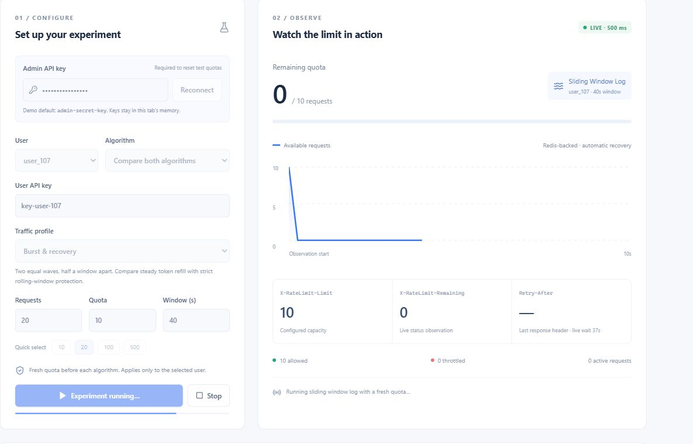
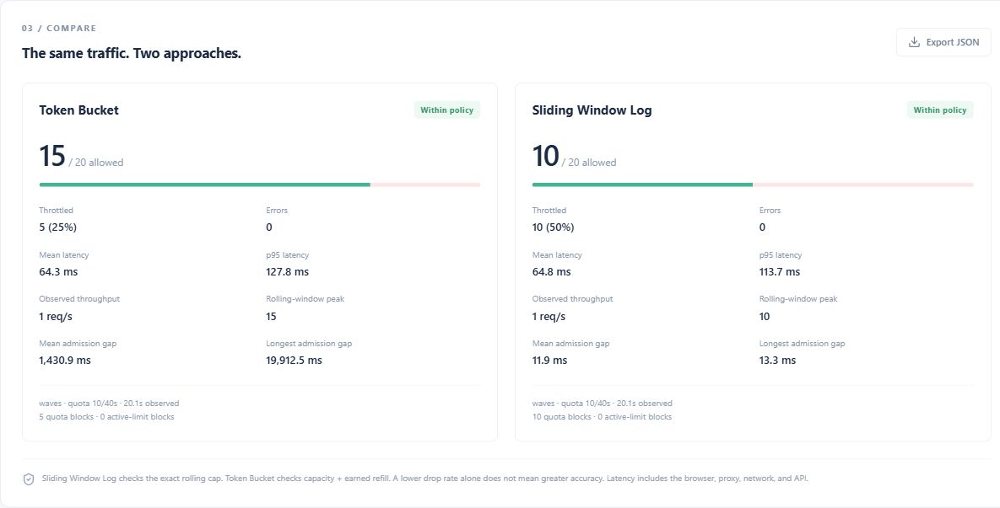
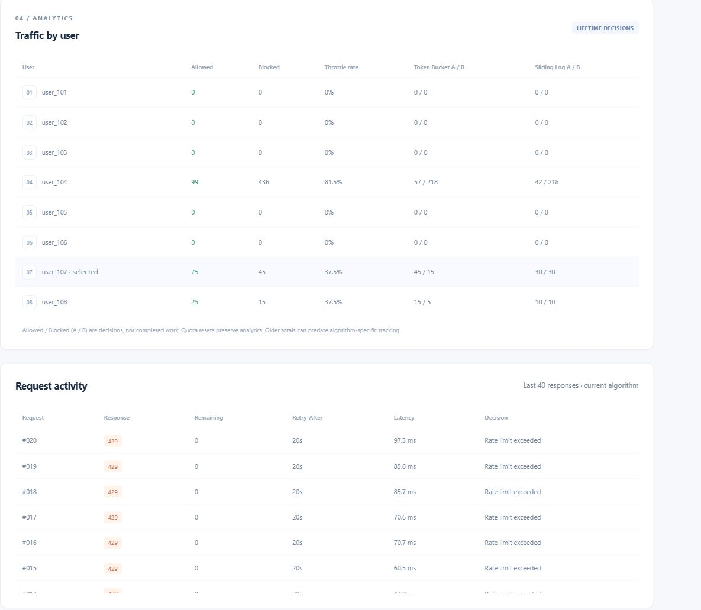
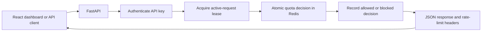

# Rate Limit Lab

A rate-limiting API with a live dashboard for exploring how traffic controls behave under load. Built with **FastAPI, Redis, React, and Vite**.

Configure individual users, send traffic, watch quotas recover, and compare **Token Bucket** with **Sliding Window Log** using real API responses.

## Why this exists

A sudden spike in API traffic can tie up connections, slow down responses, and leave fewer resources for other users. A single shared limit also makes it difficult to give different users different levels of access.

Rate Limit Lab gives each user an independent quota and a separate limit on simultaneously active requests. When a quota is exhausted, the API responds with **HTTP 429** and a calculated retry time. Redis keeps the state shared across API instances, so restarting one server does not give users a fresh allowance.

The dashboard makes those decisions visible: which requests were allowed, which were throttled, how quickly capacity returns, and how the choice of algorithm changes the outcome.

## The dashboard

### Live traffic and quota recovery

Choose a user, algorithm, request count, quota, and time window. Follow the remaining allowance, response headers, and request activity while traffic is running.



### Algorithm comparison

Run the same traffic pattern through both algorithms. Each starts with a fresh quota, and each produces its own summary of admissions, throttling, latency, throughput, and observed policy behavior.



### Per-user analytics

See cumulative allowed and blocked requests for each user, with separate counters for each algorithm. The request log shows individual HTTP responses, remaining quota, retry headers, and latency.



*Screenshots show the running application connected to Redis. Numbers come from actual API responses rather than sample chart data.*

## Features

- **Independent user quotas:** identify callers through API keys and give each user their own allowance and window.
- **Two custom algorithms:** switch a user's algorithm without restarting the API.
- **Atomic enforcement:** Redis Lua scripts combine quota checks and updates to prevent race conditions.
- **Simultaneous-request protection:** renewable, individually owned leases track work that is still running.
- **Admin controls:** configure known users and view user metadata and analytics through protected endpoints.
- **Live recovery:** observe available quota without consuming requests just to check its status.
- **Useful response headers:** `X-RateLimit-Limit`, `X-RateLimit-Remaining`, and `Retry-After` when throttled.
- **Comparable summaries:** measure allowed/blocked counts, throttle percentage, mean and p95 latency, throughput, and admission gaps.
- **Portable reports:** export comparison results and completed response records as JSON.
- **Responsive interface:** separate feature panels, readable tables, and layouts that adapt to smaller screens.

## Two ways to control traffic

### Token Bucket

Each user has a bucket with a fixed token capacity. A request consumes one token, and tokens replenish steadily over time, up to that capacity.

For a quota of 10 over 40 seconds, the bucket can initially admit 10 requests and then earns one token every four seconds.

This is useful when short bursts are acceptable but the long-term request rate should remain controlled. Redis stores the token balance and the last refill timestamp, so per-user state stays small.

### Sliding Window Log

Each admitted request receives a timestamp. On the next request, the algorithm removes entries outside the current window and checks how many remain.

For a quota of 10 over 40 seconds, no more than 10 requests are admitted within a rolling 40-second window, while that configuration remains in effect.

This is useful when an exact rolling-window cap matters. It stores one entry per recent admission, so memory use grows with the quota and traffic.

| Behavior | Token Bucket | Sliding Window Log |
| --- | --- | --- |
| Initial burst | Up to available capacity | Up to unused rolling-window quota |
| Recovery | Tokens return steadily | Capacity returns as older admissions leave the window |
| Admission policy | Capacity plus earned refill | Strict count within a rolling window |
| Redis state | Token balance and refill timestamp | Recent admission IDs and timestamps |
| Best suited to | Burst-tolerant workloads | Exact rolling-window quotas |

Both algorithms can admit an initial burst. Sliding Window Log enforces a count over time; it does not space requests evenly.

### A practical example

Send two waves of 10 requests with quota 10 and a 40-second window, placing the second wave 20 seconds after the first:

- **Token Bucket** has earned roughly five new tokens, allowing about **15 of the 20 requests**.
- **Sliding Window Log** still counts the first 10 admissions, allowing **10 of the 20 requests**.

Both outcomes follow the intended policy. A lower throttle percentage alone does not make an algorithm more accurate.

## Explore traffic patterns

| Profile | What it does | What it reveals |
| --- | --- | --- |
| Instant Burst | Schedules all requests immediately | Available burst capacity and immediate throttling |
| Burst & Recovery | Sends two waves half a window apart | Gradual refill versus rolling-window recovery |
| Sustained Traffic | Spreads requests across 1.5 windows | Admission gaps, ongoing recovery, and sustained throughput |
| Concurrency Accuracy | Schedules requests together with a 3,600-second window | Quota enforcement with minimal refill during the run |

**Requests** is the amount of traffic to send. **Quota** is the allowance being enforced. **Window** is its duration in seconds.

Comparisons run the algorithms sequentially with identical settings and a fresh quota each time. Starting a run saves the selected user's configuration in Redis; other users keep their own settings. Cumulative analytics are preserved.

Browser connection scheduling affects when requests reach the API. Dashboard latency includes HTTP and network overhead, and throughput includes any planned gaps between requests. The separate algorithm benchmark measures Redis-backed limiter calls directly.

## How it works



- **Authentication** maps an API key to a user and role.
- **Configuration** resolves the user's saved settings, starting quota, or application defaults.
- **Rate limiting** reads the current configuration and updates algorithm state atomically using Redis time.
- **Active-request leases** are renewed while work is running, released on completion, and expire if their owner disappears.
- **Analytics** records admission decisions, including requests rejected because too much work is already active.

API instances share Redis rather than maintaining independent in-memory quotas. Admin configuration and quota reset happen in one Redis transaction. If storage is unavailable, protected requests receive HTTP 503 because their allowance cannot be safely checked.

## Run locally

### Prerequisites

- Python 3.12 or later.
- Node.js 22.12 or later and npm.
- A running Redis instance, reachable through the URL in `.env`.

The commands below use PowerShell from the project root.

### 1. Install the backend

```powershell
python -m venv .venv
.\.venv\Scripts\python.exe -m pip install -r requirements.txt

if (-not (Test-Path .env)) {
    Copy-Item .env.example .env
}
```

The default Redis URL is `redis://localhost:6379/0`. Update `.env` if your instance uses a different address.

If Redis is not already running, Docker is one option:

```powershell
docker run -d --name rate-limit-redis -p 6379:6379 -v rate-limit-redis-data:/data redis:7 redis-server --appendonly yes
```

### 2. Start the API

```powershell
.\.venv\Scripts\python.exe -m uvicorn app.main:app --port 8001
```

Interactive API documentation is available at [http://127.0.0.1:8001/docs](http://127.0.0.1:8001/docs).

### 3. Start the frontend

Open a second terminal:

```powershell
cd frontend
npm ci
npm run dev
```

Open [http://127.0.0.1:5173](http://127.0.0.1:5173).

The Vite development server forwards API requests to port 8001. To use another backend address, set `API_PROXY_TARGET` before starting Vite:

```powershell
$env:API_PROXY_TARGET="http://127.0.0.1:8011"
npm run dev
```

### 4. Connect and send traffic

1. Enter the admin key configured in `.env`. The local demonstration default is `admin-secret-key`.
2. Select a user and confirm their API key. For example, `user_104` uses `key-user-104`.
3. Click **Connect**.
4. Choose one algorithm or **Compare both algorithms**.
5. Set the traffic profile, request count, quota, and window, then start the run.
6. Watch quota recover, review each summary, or export the results.

Credentials remain in the current tab's memory and are excluded from exported reports. The bundled users and keys are demonstration identities.

### Serve a frontend build from FastAPI

```powershell
cd frontend
npm run build
```

Restart the API after building. FastAPI serves the generated frontend at [http://127.0.0.1:8001](http://127.0.0.1:8001), so a separate Vite server is no longer required.

### Multiple API instances

The included Compose setup starts Redis, two API instances, and Nginx:

```powershell
docker compose up --build
```

The API instances listen on ports 8001 and 8002, with Nginx on port 8000. Responses include `X-Served-By` to identify the serving instance. This container setup currently packages the backend; run the React dashboard separately.

## API overview

Send credentials in the `X-API-Key` header.

| Method | Endpoint | Access | Purpose |
| --- | --- | --- | --- |
| GET | `/api/data` | Valid API key | Make a protected request and consume quota |
| GET | `/api/status` | Valid API key | Read current allowance without consuming it |
| POST | `/api/config` | Admin | Save a known user's quota, window, and algorithm; reset their rate state |
| GET | `/api/analytics` | Admin | Read cumulative per-user and per-algorithm decisions |
| GET | `/api/users` | Admin | Read user IDs and configuration metadata |
| GET | `/health` | Public | Check API and Redis availability |

A throttled response includes a calculated wait:

```http
HTTP/1.1 429 Too Many Requests
X-RateLimit-Limit: 10
X-RateLimit-Remaining: 0
Retry-After: 4
Content-Type: application/json

{
  "error": "Rate limit exceeded",
  "retry_after": 4
}
```

The retry value depends on the current algorithm state. Active-request rejections use a separate message, `Too many simultaneous requests`, and do not consume rate quota.

## Configuration

| Environment variable | Default | Purpose |
| --- | --- | --- |
| `REDIS_URL` | `redis://localhost:6379/0` | Shared Redis connection |
| `REDIS_KEY_PREFIX` | Empty | Optional namespace for application data |
| `RATE_LIMIT_ALGORITHM` | `sliding_window_log` | Default algorithm when no user-specific selection exists |
| `DEFAULT_LIMIT` | `5` | Fallback user quota |
| `DEFAULT_WINDOW_SECONDS` | `60` | Fallback window duration |
| `MAX_ACTIVE_REQUESTS_PER_USER` | `200` | Simultaneously active requests allowed per user |
| `ACTIVE_REQUESTS_TTL_SECONDS` | `30` | Renewable active-request lease duration |
| `REDIS_MAX_CONNECTIONS` | `100` | Maximum Redis connections per API process |
| `ADMIN_API_KEY` | `admin-secret-key` | Demonstration admin credential |

Saved user configuration takes priority over source-defined starting quotas and fallback defaults. See `.env.example` for the complete list of settings.

## Project layout

```text
app/
  controllers/         HTTP endpoints
  models/              User, quota, and response data structures
  services/
    algorithms/        Python algorithm interfaces
    lua/               Atomic Redis decisions and request leases
  views/               JSON responses and HTTP headers
  dependencies.py      Authentication and request enforcement
  main.py              Application startup and route registration
frontend/
  src/components/      Dashboard feature panels
  src/hooks/           Connection, polling, and experiment lifecycle
  src/lib/             HTTP transport, traffic schedules, and metrics
  src/styles.css       Shared styles and responsive layouts
benchmarks/            Direct algorithm performance comparison
docs/screenshots/      Captured frontend activity and results
```

The implementation keeps scheduling, admission decisions, response formatting, and visualization separate, making each part easier to understand and extend.
